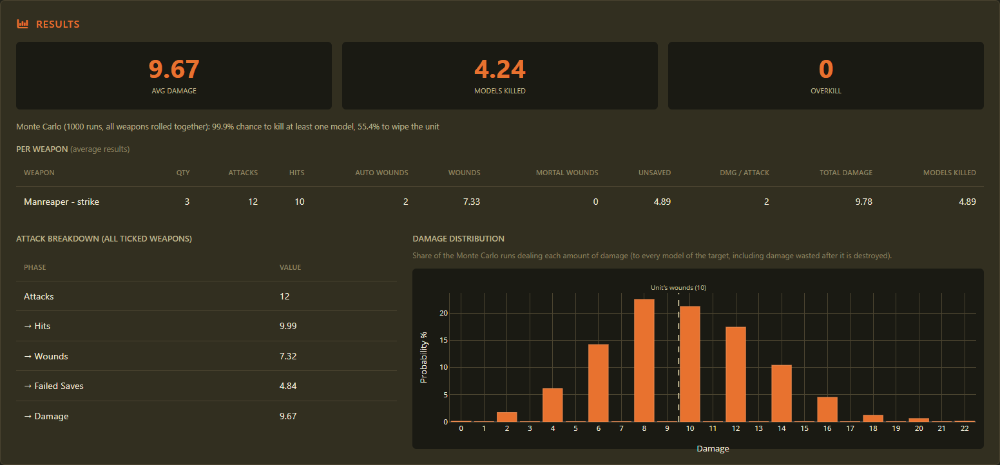

# 40K Combat Simulator

Work out what your Warhammer 40,000 (11th edition) units really do. Pick an attacker and a target and see the expected damage, the chance to kill, and how the dice could fall. Then build whole army lists and test them against anything.

## Choose your guide

| [📖 **User guide**](docs/user-guide.md) | [🛠️ **Technical overview**](docs/technical-overview.md) |
| --- | --- |
| Getting started, every page explained with screenshots, and how the maths works, in plain English. **Start here if you just want to use the app.** | Running from source, tests, data sources, architecture and releases. **For working on the code.** |

## Quick start

1. Download the latest zip for **Windows** or **Linux** from the [Releases page](https://github.com/mleech142/40k-combat-simulator/releases) and unzip it.
2. Run **`40kCombatSimulator.exe`** on Windows (if it warns you: **More info → Run anyway**), or `./40kCombatSimulator/40kCombatSimulator` from a terminal on Linux.
3. On the **Setup** page that opens, press **both** Download buttons: units and points, then rules and stratagems.
4. Pick a page from the menu and start simulating.

## What's inside

- **Simulator:** one unit against one target, with leaders, rules, stratagems, battle conditions and a dice-rolled damage spread.
- **Armies:** build and check army lists: detachments, leaders, enhancements, wargear and a Warlord.
- **Analytics:** your whole army against real units or benchmark targets, with an analysis of its strengths and gaps.
- **Data:** browse every faction, unit, weapon and rule.

## Credits

Unit data comes from [BSData](https://github.com/BSData/wh40k-11e) (community-maintained); rules and stratagems are powered by [Wahapedia](https://wahapedia.ru/). Neither is included with the app: each user downloads their own copy.

MIT licensed. *A fan project, not affiliated with or endorsed by Games Workshop. Warhammer 40,000 is a trademark of Games Workshop Ltd.*
