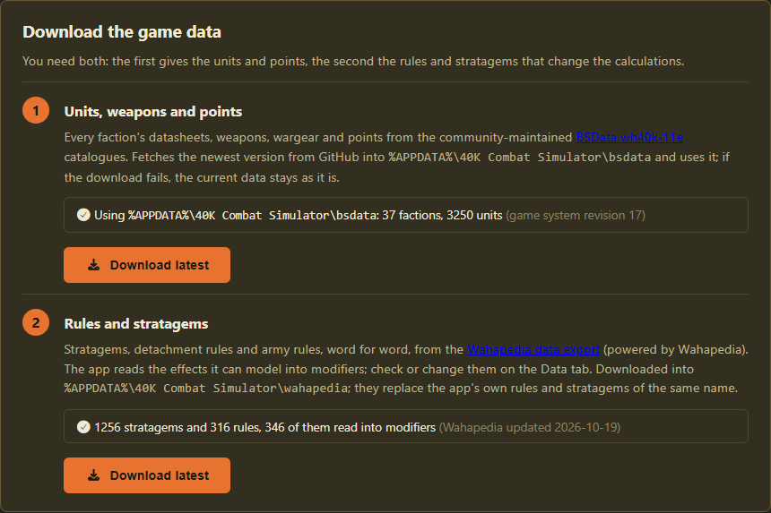
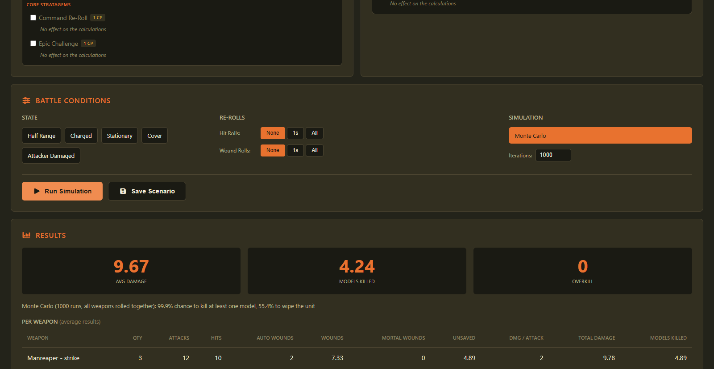
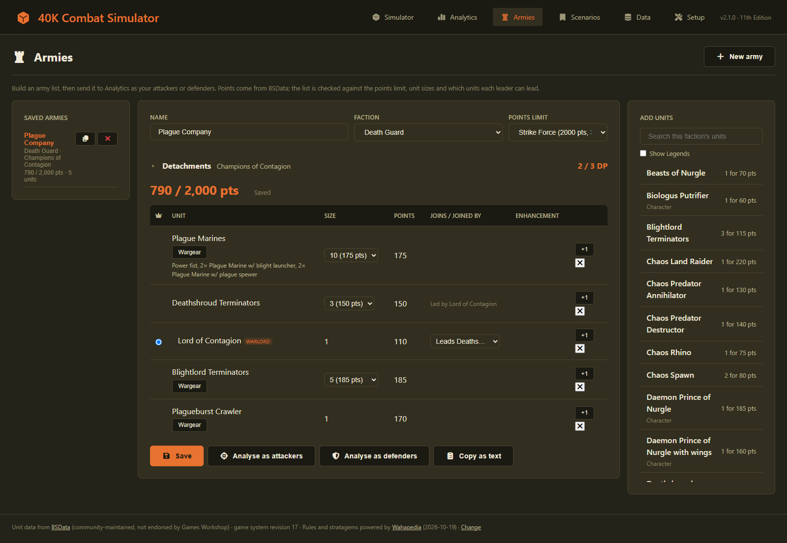
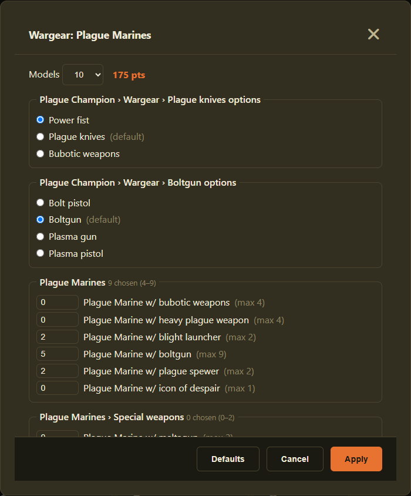
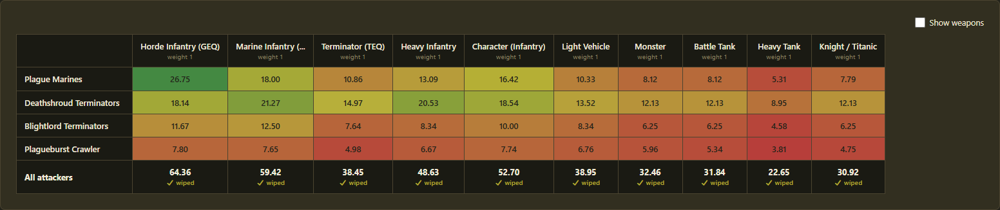
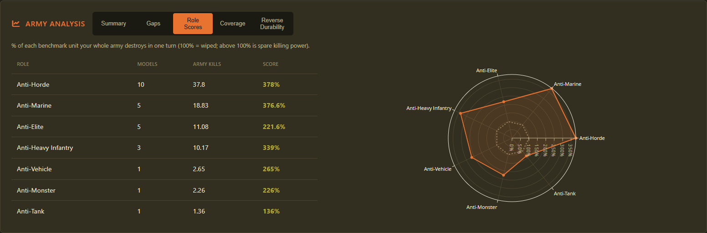

# User guide

How to set up the 40K Combat Simulator, use each page, and read what it tells you, with a plain-English look at the maths behind it.

**Contents:** [Getting started](#getting-started) · [Simulator](#simulator-one-unit-against-one-target) · [Armies](#armies-build-a-list) · [Analytics](#analytics-a-whole-army) · [Rules and stratagems](#rules-and-stratagems) · [How the maths works](#how-the-maths-works) · [Your data](#your-data-and-updates) · [Troubleshooting](#troubleshooting)

---

## Getting started

1. Download the latest `40kCombatSimulator-…-windows.zip` from the [Releases page](https://github.com/mleech142/40k-combat-simulator/releases) and unzip it anywhere.
2. Double-click **`40kCombatSimulator.exe`**. Windows may say "Windows protected your PC" (the app isn't signed): click **More info → Run anyway**.
3. Your browser opens the app on the **Setup** page. Press **both** Download buttons:



| Step | What it gets you |
| --- | --- |
| **1. Units, weapons and points** | Every faction's datasheets, weapons, wargear and points (from BSData) |
| **2. Rules and stratagems** | Stratagems, detachment rules and army rules, word for word (from Wahapedia) |

That's it. Pick any page from the menu at the top. Close the black console window to stop the app.

**On Linux:** download the `…-linux.zip` instead, unzip it, and run it from a terminal:

```bash
./40kCombatSimulator/40kCombatSimulator
```

Your browser opens the app as above; press Ctrl+C in the terminal to stop it. It needs a reasonably recent distribution (for example Ubuntu 22.04, Debian 12 or Fedora 36, or newer). Your data lives in `~/.local/share/40K Combat Simulator/`.

> The app doesn't come with any game data; each person downloads their own copy. Neither source is made by Games Workshop.

---

## Simulator: one unit against one target

The quickest way to answer "how much damage does this do to that?"



1. **Attacker:** start typing a unit's name and pick it. Its weapons appear, ticked, with how many models carry each. Optional wargear is listed underneath, unticked.
2. **Shooting or Melee:** choose which weapons fire.
3. **Defender:** pick a unit and set how many models it has.
4. **Optional:** attach a **leader** to either unit, tick **rules and stratagems**, or set **battle conditions** (cover, half range, charged, re-rolls).
5. Press **Run Simulation**.


**Reading the results**

| You see | It means |
| --- | --- |
| **Avg damage** | The damage you'd expect on average, after saves and Feel No Pain |
| **Models killed** | How many models that removes on average |
| **Overkill** | Damage wasted after the whole unit is dead |
| **Per weapon** | The same, weapon by weapon, with each step (hits, wounds, unsaved) |
| **Damage distribution** | *Monte Carlo only:* how often each amount of damage happened over 1,000 battles. The dashed line marks the target's total wounds |

Tick **Monte Carlo** (under *Simulation*) to also see the chance to kill at least one model and the chance to wipe the unit.

---

## Armies: build a list

Build an army once, then test it against anything.



1. Press **New army**, choose a **faction** and a **points limit** (Incursion, Strike Force or Onslaught).
2. Open **Detachments** and tick one or more. Each costs Detachment Points (DP), and the counter shows what's left.
3. Click units in **Add units** on the right. For each one:
   - choose its **size** (the points update);
   - for a leader or support unit, choose which unit it **joins**;
   - pick an **enhancement** for a Character;
   - mark your **Warlord** with the crown column.
4. Press **Wargear** on a unit to choose its weapons:



   "Pick one" choices are radio buttons; "how many" choices are number boxes with their limits shown. Points, problems and the resulting loadout update as you go. **Apply** keeps your choices; **Defaults** goes back to the datasheet's wargear.

5. **Save**, then **Analyse as attackers** or **Analyse as defenders** to open it in Analytics.

**The list checks itself.** Anything that breaks a rule is listed in orange under the points (you can still save):

- **Points:** the points limit, and Detachment Points for the battle size.
- **Copies:** the rule of three (six for Battleline, one for Epic Heroes).
- **Characters:** one Warlord (a Character); enhancements on Characters only, never Epic Heroes, each once, up to the battle size's limit.
- **Units:** legal unit sizes; leaders and support units joining units they're allowed to.
- **Wargear:** BSData's own limits, such as "max 1 per 5 models".

**Copy as text** gives you the list ready to paste into a message.

---

## Analytics: a whole army

Every unit in your army against every target, in one grid.



- **Attackers:** add units with **+ Add Unit**, or send an army from the Armies page.
- **Defenders:** your opponent's real units, or **Generic profiles**: benchmark targets such as Marine Infantry (MEQ), Terminators (TEQ) and tanks.
- Press **Run Matrix**. Greener is better. Change **Display** to see models killed, % destroyed or points efficiency instead of damage, and click any cell for its full breakdown.

Underneath, **Army Analysis** sums up your army:



| Tab | Answers |
| --- | --- |
| **Summary** | How much does the army kill per turn, and which unit is the most efficient? |
| **Gaps** | Which targets does it struggle with? |
| **Role Scores** | How good is it against hordes, elites, vehicles, monsters…? (100% = wipes the benchmark unit in one turn) |
| **Coverage** | Which Toughness and Save values can it handle? |
| **Reverse Durability** | How much would *their* army do to *yours*? |

---

## Rules and stratagems

Once you've downloaded the rules (Setup, step 2), each side on the Simulator and Analytics has a **Rules & Stratagems** panel:

1. Open **Detachments** in the panel and tick yours. Their stratagems appear.
2. Tick the ones you're using. Those that change the maths show what they do (e.g. *Lethal Hits*); others are listed as *No effect on the calculations*.
3. Hover over a stratagem to see when it applies. Some only work in certain situations ("if your unit is within range of an objective"). Ticking it means you're saying the situation applies.

The app reads each stratagem's text and works out its effect: about two thirds of the ones that matter in a fight. To check or change how one is read, open the **Data** tab, expand a faction and press **Edit** on it. Your change is kept even when you download the rules again.

**Leaders and enhancements** work the same way. The app reads "While this model is leading a unit…" from each leader's datasheet, and each enhancement's text, and applies what it can.

---

## How the maths works

Every attack goes through the same steps you'd roll at the table:

```text
Attacks ──► Hit roll ──► Wound roll ──► Saving throw ──► Damage ──► Feel No Pain
```

| Step | What decides it |
| --- | --- |
| **Attacks** | The weapon's A × the models carrying it (dice like D6 count as their average, 3.5). Blast and Rapid Fire add attacks |
| **Hit** | BS or WS. Cover makes the shooter's BS one worse. A 6 is a Critical Hit: Sustained Hits adds hits, Lethal Hits wounds automatically. Torrent always hits |
| **Wound** | Strength against Toughness: double = 2+, more = 3+, equal = 4+, less = 5+, half or less = 6+. Anti-X lowers the critical roll; Devastating Wounds skip the save |
| **Save** | Armour save made worse by AP, or the invulnerable save if that's better |
| **Damage** | The weapon's D (plus Melta at half range). Damage can't spill from one model to the next |
| **Feel No Pain** | Each point of damage can be ignored on the FNP roll |

Modifiers to hit and to wound are capped at **+1 / −1**, as in the rules.

### Two ways to calculate

| | **Averages** (default) | **Monte Carlo** |
| --- | --- | --- |
| How | Works out the exact average of every step | Rolls the dice for real, 1,000 times or more |
| Gives | Expected damage and models killed | The same, plus the spread of results and the chance to kill or wipe |
| Use it for | Comparing options quickly | "How likely am I to kill it?" and swingy weapons |

Both use the same rules, and a check in the tests makes sure they agree.

### Units with a leader

When a unit with a leader is the target, attacks go to the bodyguard models first, then to the leader once they're all dead. Each part uses its own stats. For the leader, the averages show the damage it's likely to take, and Monte Carlo shows how often it dies.

### What isn't modelled

Things that depend on the table rather than the dice: movement, charges, Precision (picking out a leader), "once per battle" effects and most auras. The app reads what it can from rules text; anything else is shown as *No effect on the calculations* so you know it isn't counted.

---

## Your data and updates

- **To update the game data,** open **Setup** and press **Download latest** again. Saved scenarios and armies keep working.
- **To update the app,** download the new release and replace the unzipped folder. Nothing is lost: your data lives in `%APPDATA%\40K Combat Simulator\` (paste that into File Explorer's address bar to find it). It holds:
  - the downloaded game data;
  - your saved scenarios, comparisons and armies;
  - your own rules, custom units and edits.

---

## Troubleshooting

| Problem | Try |
| --- | --- |
| "Windows protected your PC" | **More info → Run anyway** (the app isn't code-signed) |
| Linux: "Permission denied" | `chmod +x 40kCombatSimulator/40kCombatSimulator`, then run it again |
| Linux: an error mentioning `GLIBC` | Your distribution is too old for the download: run from source instead (see the [technical overview](technical-overview.md#run-from-source)) |
| The browser didn't open | Open the address shown in the black console window (usually `http://127.0.0.1:5000`) |
| No units in the lists | Go to **Setup** and press **Download latest** in step 1 |
| No stratagems | Go to **Setup** and press **Download latest** in step 2, then tick a detachment |
| A stratagem says *No effect on the calculations* | It's listed for reference. If it should do something, set its effect on the **Data** tab |
| A number looks wrong | **Setup → Import notes** lists anything the importer couldn't read |
